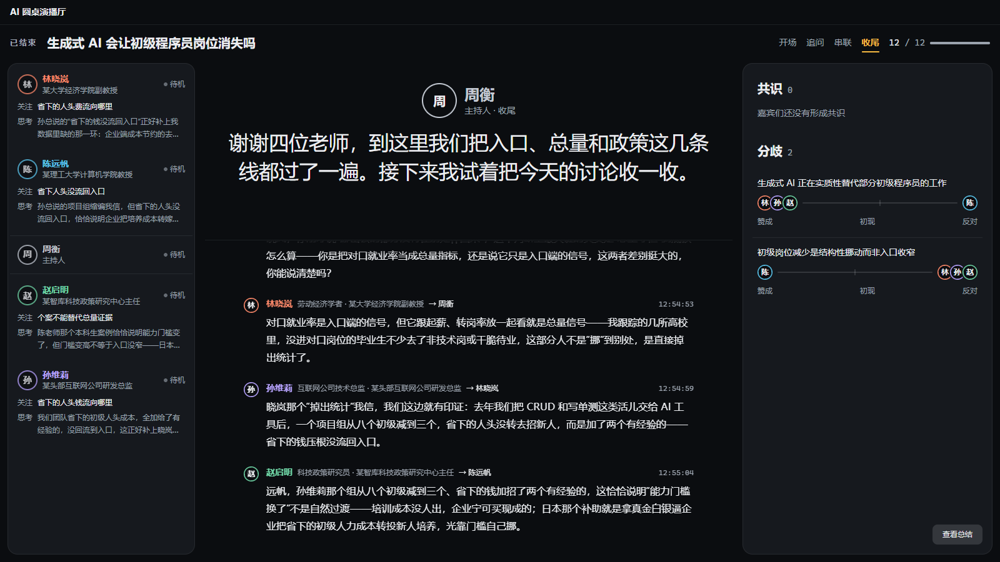
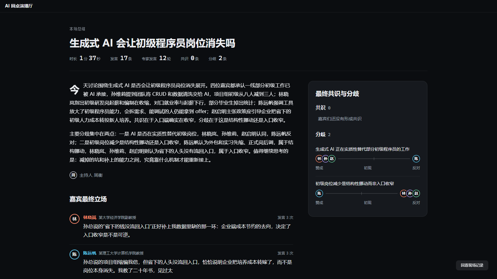

# AI Panel Studio · AI 圆桌演播厅

输入一个话题，系统用大模型生成一位主持人和一组立场冲突的专家，确认阵容后在浏览器里实时观看一场圆桌讨论：主持人开场、追问、串联和收尾，专家按各自的发言意图举手、抢答、补充或反驳，共识与分歧随发言实时更新，结束时主持人给出自然语言总结。

[](docs/media/demo.mp4)

25 秒演示视频：[docs/media/demo.mp4](docs/media/demo.mp4)（1080p，带音效）。一束追光贯穿全片：从输入框的光标开始，点亮嘉宾席位，在发言人之间跳动，留下的轨迹拉成立场光谱，最后落进总结页的首字。画面用 [onetake](docs/media/src/README.md) 按产品界面重建，内容来自一场真实的 DeepSeek 讨论；字体为 Noto Sans SC、Inter、Geist Mono（均为 OFL 授权）。





截图来自一场真实的 DeepSeek 讨论（话题：生成式 AI 会让初级程序员岗位消失吗）。

## 线上演示

https://roundtable.heyqi.xyz （需要访问密码，请联系作者获取）。演示站调用真实的 DeepSeek，为保护额度：同时只进行 1 场讨论，每天最多开始 20 场。

## 快速开始

### 方式一：Docker（一条命令）

```bash
docker compose up --build
```

打开 http://localhost:8080 。默认 `LLM_MODE=mock`，不联网、不花钱。使用真实模型时，在项目根目录新建 `.env`：

```
LLM_MODE=deepseek
DEEPSEEK_API_KEY=你的 Key
```

### 方式二：本机运行

环境要求：Python 3.11、Node.js 20 及以上。

```bash
# 后端
cd backend
python -m venv .venv
.venv\Scripts\pip install -r requirements.txt      # macOS / Linux 用 .venv/bin/pip
.venv\Scripts\python -m db.seed                    # 导入 5 场预设样例
.venv\Scripts\uvicorn app.main:create_app --factory --host 127.0.0.1 --port 8000
```

```bash
# 前端（另开一个终端）
cd frontend
npm install
npm run dev
```

打开 http://127.0.0.1:5173 。前端开发服务器把 `/api` 转发到 `127.0.0.1:8000`。

后端默认 `LLM_MODE=mock`。切到真实模型：启动前设置环境变量 `LLM_MODE=deepseek` 和 `DEEPSEEK_API_KEY`，或者参考 `backend/.env.example` 写一个 `.env`，再用 `uvicorn ... --env-file .env` 启动。

## 环境变量

所有变量都由后端读取。大模型 Key 只存在于后端进程的环境变量里，前端代码和接口响应中都没有它。

| 变量 | 默认值 | 说明 |
| --- | --- | --- |
| `LLM_MODE` | `mock` | `mock` 使用确定性的 FakeLLM；`deepseek` 调用 DeepSeek |
| `DEEPSEEK_API_KEY` | 无 | `LLM_MODE=deepseek` 时必填 |
| `DEEPSEEK_MODEL` | `deepseek-v4-flash` | 模型名，调用时关闭思考模式 |
| `DEEPSEEK_BASE_URL` | `https://api.deepseek.com` | OpenAI 兼容接口地址 |
| `TURN_DELAY_S` | `1.5` | 两条发言之间的停顿，单位秒 |
| `MAX_EXPERT_TURNS` | `12` | 专家发言轮数上限，达到后进入总结 |
| `MAX_RUNNING` | `3` | 同时进行的讨论数上限，超出返回 429 |
| `SSE_MAX_STREAM_S` | `0` | 单条 SSE 连接最长存活秒数，到时服务端断开，浏览器带 `Last-Event-ID` 续传；0 表示不限制 |
| `APP_PASSWORD` | 无 | 设置后进站要输访问密码（线上演示用），未设置时不启用 |
| `APP_SECRET` | 随机 | 签名登录 Cookie 的密钥；不设置时每次启动随机生成，重启后需重新登录 |
| `COOKIE_SECURE` | `false` | 线上走 HTTPS 时设为 `true` |
| `MAX_STARTS_PER_DAY` | `0` | 每天最多开始几场讨论，0 表示不限；超出返回 429，保护模型额度 |
| `MAX_CREATES_PER_DAY` | `0` | 每天最多发起几场讨论，0 表示不限 |
| `APS_DATABASE_URL` | `sqlite:///backend/data/app.db` | SQLite 数据库地址 |
| `API_TARGET` | `http://127.0.0.1:8000` | 仅前端开发服务器使用：`/api` 转发的目标 |

## 技术选型

| 层 | 选择 | 理由 |
| --- | --- | --- |
| 后端 | FastAPI + asyncio | 每场讨论是一个长时间运行的协程，asyncio 天然支持；Pydantic 同时承担接口校验和大模型输出校验 |
| 数据库 | SQLite（作业指定），SQLAlchemy Core | 开启 WAL 和外键；建表以 `schema.sql` 为唯一来源，用 CHECK 约束兜住枚举、长度、JSON 格式 |
| 实时推送 | SSE | 只需要服务端向浏览器单向推送；浏览器的 `EventSource` 自带断线重连和 `Last-Event-ID` |
| 大模型 | DeepSeek（OpenAI 兼容接口） | 结构化输出用 JSON 模式加 Pydantic 校验，失败重试；关闭思考模式，从源头不产生隐藏思维链 |
| 测试替身 | FakeLLM | 按用途返回确定性内容，可用脚本覆盖；测试不联网、不花钱、结果可复现 |
| 前端 | React 19 + Vite + TypeScript | 不引入状态管理和路由库，数据流集中在 `useDiscussion` 一个 hook 里 |
| 端到端测试 | Playwright | 自动拉起前后端，用本机 Chrome 运行 |

各项取舍的详细说明见 [docs/architecture.md](docs/architecture.md)。

## 主要 API

完整的请求、响应和错误码见 [docs/API.md](docs/API.md)。所有错误统一为 `{code, message, details}`。

| 方法 | 路径 | 用途 |
| --- | --- | --- |
| POST | `/api/discussions` | 创建讨论并生成嘉宾阵容 |
| POST | `/api/discussions/{id}/lineup/regenerate` | 重新生成阵容 |
| POST | `/api/discussions/{id}/start` | 确认阵容并开始，返回 202 |
| POST | `/api/discussions/{id}/abort` | 结束进行中的讨论 |
| GET | `/api/discussions` | 首页列表 |
| GET | `/api/discussions/{id}` | 讨论快照：阵容、发言、条目、小窗状态和 `last_event_id` |
| GET | `/api/discussions/{id}/stream` | SSE 事件流，支持 `Last-Event-ID` 和 `?after=` 断点续传 |
| GET | `/api/health` | 健康检查，只返回是否配置了大模型，不返回 Key |

## 测试

```bash
# 后端：77 个测试，LLM_MODE=mock 下运行
cd backend
.venv\Scripts\python -m pytest

# 端到端：8 个测试，自动拉起前后端，需要本机安装 Chrome
cd e2e
npm install
npx playwright test
```

真实模型评测（会产生费用，一场约 ¥0.07）：

```bash
cd backend
.venv\Scripts\python -m scripts.live_run --label demo
.venv\Scripts\python -m scripts.check_attribution demo
```

报告输出到 `backend/data/live/demo/report.md`。

## 已完成的能力

| 作业要求 | 实现方式 | 验证 |
| --- | --- | --- |
| 首页列表、发起讨论 | 按状态分组，进行中的卡片显示最新一句发言 | E2E 主流程 |
| 嘉宾生成 | 模型生成，校验人数、立场不重复；颜色由系统按色板分配 | 后端 4 个测试 |
| 演播厅：主持人主持、专家自主发言 | 每位专家独立给出发言意图，调度器按紧迫度和沉默时长选人，同一专家最多连续 2 次；每 3 条专家发言主持人插话 | 后端调度器测试 + 真实模型评测 |
| 专家小窗 | 待机、准备发言、发言中三种状态；公开思考摘要经过「不含发言意图」校验 | 后端校验测试 |
| 实时共识与分歧 | 每条发言后增量提炼，每次站队必须有本人发言为证；坏输出保留上一版 | 后端 6 个测试 + 真实模型评测 |
| Transcript | 只显示「→ 被回应人」，不显示内部事件和发言类型 | E2E 禁止项检查 |
| 自然语言总结 | 模型输出 JSON 时自动解包，失败时用条目拼兜底总结 | 后端 4 个测试 |
| Key 只在后端 | 只从环境变量读取 | 接口不返回 Key |
| 多讨论隔离 | 每场一个后台任务，事件总线按讨论分频道 | 后端 2 个测试 + E2E |
| 实时推送 | SSE，先拉快照再从 `last_event_id` 接流，断线带 `Last-Event-ID` 续传 | E2E 中途加入、断线重连 |
| 中文响应式、页面不滚动 | 三档布局：≥1600 三栏、1024～1599 席位条在上加两栏、<1024 标签切换 | E2E 三种视口 |

作业中的 9 条禁止项及对应测试见 [docs/PRD.md](docs/PRD.md)「验收标准：禁止项」。

## 部署

`deploy/` 下是演示站的部署配置：前端 nginx 容器接入已有的 Cloudflare 隧道网络，后端只在项目内网。服务器上的 `.env`（模型 Key、访问密码、每日上限）权限 600，不进仓库。更新演示站：

```bash
bash deploy/deploy.sh    # 本地跑后端测试 → 上传当前提交 → 备份数据库 → 重建容器 → 健康检查
```

## 后续改进

- **姓名映射**：模型偶尔把嘉宾姓名填进 id 字段，目前靠 Prompt 约束；在代码里把姓名映射成 id，可作为第二层保障。
- **发言长度**：真实模型的发言平均约 90 字，常用破折号把多个分句连成一句；可以在 Prompt 里加字数上限，或按字数重新生成。
- **发言均衡**：调度器只看紧迫度和沉默时长，真实讨论里会出现两位专家连续对攻；可以加入发言次数的惩罚项。
- **共识偏保守**：收紧站队规则后，模型很少提出共识；可以让主持人的串联发言直接触发一次共识提炼。
- **重启恢复**：服务重启时，进行中的讨论标记为中止；可以从事件表恢复讨论上下文并继续。
- **多实例部署**：事件总线在进程内；多实例时需要换成 Redis Pub/Sub，并让 SQLite 换成 PostgreSQL。
- **成本统计**：目前用余额差额计算一场的花费；可以把每次调用的 token 用量写进 `llm.call` 事件。

## 目录结构

```
backend/
  app/
    main.py           应用工厂 create_app
    api.py            HTTP 接口和 SSE 接口
    orchestrator.py   后台任务管理：开始、中止、重启恢复
    discussion.py     单场讨论的推进循环
    scheduler.py      发言调度（纯函数）
    insights.py       共识与分歧的增量更新
    llm.py            大模型统一入口，mock / deepseek 切换
    fake_llm.py       测试用的确定性大模型替身
    prompts/          Prompt 模板，每个用途一个文件
    repo.py  sse.py  bus.py  schemas.py  ...
  db/schema.sql  db/seed.py
  scripts/            真实模型评测脚本
  tests/              后端测试
frontend/src/
  pages/              首页、讨论页、演播厅
  components/         席位、舞台、记录、共识分歧、总结等组件
  useDiscussion.ts    快照 + SSE 的数据流
e2e/                  Playwright 端到端测试
docs/                 PRD、ER、API、架构说明、工作流说明、Prompt 记录
```

## 文档

| 文档 | 内容 |
| --- | --- |
| [docs/PRD.md](docs/PRD.md) | 用户故事、验收标准、讨论推进规则、禁止项的可测试标准 |
| [docs/ER.md](docs/ER.md) | 6 张表的 ER 图、字段说明、讨论状态机 |
| [docs/API.md](docs/API.md) | 接口契约、错误码、SSE 事件格式 |
| [docs/architecture.md](docs/architecture.md) | 模块划分、一轮发言的时序、关键设计取舍 |
| [docs/workflow.md](docs/workflow.md) | 开发过程与工作流说明 |
| [docs/prompts.md](docs/prompts.md) | 各阶段的核心 Prompt 原文和复盘 |
