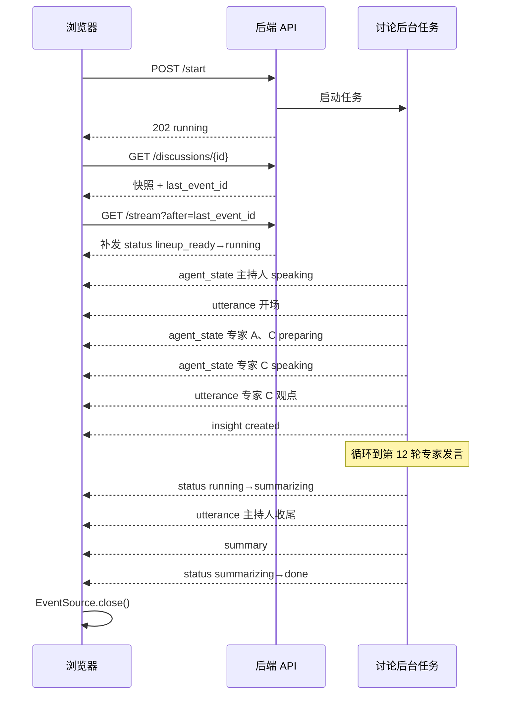

# API 契约

本文档定义后端 HTTP 接口和 SSE 事件。字段含义见 [ER.md](ER.md)，业务规则见 [PRD.md](PRD.md)。后端用 Pydantic 模型实现这里的每个请求体和响应体。

## 通用约定

- 基础路径：`/api`。请求和响应都是 JSON，编码 UTF-8。
- 时间字段为 UTC ISO 8601 字符串。
- 响应只包含下文列出的字段。后端用 Pydantic 响应模型按白名单序列化，模型返回的额外字段（例如 `reasoning_content`）无法进入响应。

### 错误格式

所有错误都返回下面的结构，包括 FastAPI 默认的参数校验错误（后端改写默认的 422 处理器）。

```json
{
  "code": "INVALID_STATE_TRANSITION",
  "message": "讨论正在进行中，不能重新生成阵容",
  "details": null
}
```

| 字段 | 类型 | 说明 |
| --- | --- | --- |
| code | string | 机器可读的错误码，前端按它分支处理 |
| message | string | 中文说明，可以直接显示给用户 |
| details | object \| null | 可选的补充信息，例如校验失败的字段列表、阵容生成失败时的讨论 id |

### 错误码

| HTTP 状态码 | code | 含义 |
| --- | --- | --- |
| 404 | DISCUSSION_NOT_FOUND | 讨论不存在 |
| 409 | INVALID_STATE_TRANSITION | 当前状态不允许这个操作 |
| 422 | VALIDATION_ERROR | 请求参数不合法，`details.fields` 列出出错字段 |
| 429 | TOO_MANY_RUNNING | 同时运行的讨论已达 3 场 |
| 502 | LLM_UNAVAILABLE | 模型服务调用失败或超时，重试后仍未成功 |
| 502 | LLM_BAD_OUTPUT | 模型输出没有通过校验，重试后仍未成功 |
| 500 | INTERNAL_ERROR | 其他未预期的错误 |

## 数据结构

### Participant

```json
{
  "id": "3f2a9c...",
  "role": "expert",
  "seat_no": 1,
  "name": "林晓岚",
  "profession": "劳动经济学者",
  "title": "某大学经济学院副教授",
  "stance": "AI 会压缩初级岗位，但不会让它消失",
  "persona": "长期研究技术变革对就业的影响，说话习惯引用数据",
  "color": "#E4572E"
}
```

### Utterance

```json
{
  "id": 128,
  "seq": 9,
  "participant_id": "3f2a9c...",
  "act": "rebut",
  "content": "这个比例只统计了大厂。中小公司里，初级岗位反而在增加。",
  "reply_to_utterance_id": 126,
  "addressed_participant_id": null,
  "created_at": "2026-11-18T08:31:05Z"
}
```

### AgentState

```json
{
  "participant_id": "3f2a9c...",
  "status": "preparing",
  "focus": "中小企业的招聘数据",
  "public_thought": "想指出刚才的数据只覆盖了大厂",
  "version": 7,
  "updated_at": "2026-11-18T08:31:02Z"
}
```

### Insight

```json
{
  "id": "a81c0e...",
  "kind": "divergence",
  "content": "AI 会在五年内显著减少初级程序员岗位",
  "supporter_ids": ["3f2a9c..."],
  "opponent_ids": ["77b1d4...", "c90e3a..."],
  "status": "emerging",
  "evidence_utterance_ids": [124, 128],
  "version": 2,
  "updated_at": "2026-11-18T08:31:09Z"
}
```

### DiscussionSummary（列表项）

```json
{
  "id": "e5d1b2...",
  "topic": "AI 会取代初级程序员吗",
  "status": "running",
  "expert_count": 4,
  "is_seed": false,
  "participants": [
    { "id": "...", "role": "host", "name": "周衡", "color": "#4A5568" }
  ],
  "utterance_count": 9,
  "latest_utterance": "这个比例只统计了大厂。中小公司里，初级岗位反而在增加。",
  "created_at": "2026-11-18T08:28:40Z",
  "started_at": "2026-11-18T08:30:00Z",
  "ended_at": null
}
```

`participants` 只含 `id`、`role`、`name`、`color` 四个字段，用于首页显示色块。`latest_utterance` 在没有发言时为 `null`。

### DiscussionDetail

```json
{
  "id": "e5d1b2...",
  "topic": "AI 会取代初级程序员吗",
  "status": "running",
  "status_reason": null,
  "expert_count": 4,
  "max_expert_turns": 12,
  "expert_turns": 5,
  "is_seed": false,
  "summary": null,
  "summary_source": null,
  "created_at": "2026-11-18T08:28:40Z",
  "started_at": "2026-11-18T08:30:00Z",
  "ended_at": null,
  "participants": [ "Participant ..." ],
  "utterances": [ "Utterance ...，按 seq 升序" ],
  "insights": [ "Insight ...，按 created_at 升序" ],
  "agent_states": [ "AgentState ...，每位嘉宾一条" ],
  "last_event_id": 131
}
```

`last_event_id` 是生成这份快照时，本场讨论最新一条 `public` 事件的 id。没有任何事件时为 `0`。后端在同一个读事务里查询快照内容和这个 id，前端把它传给 SSE 的 `after` 参数，接上实时流。

## 接口

| 方法 | 路径 | 用途 |
| --- | --- | --- |
| POST | /api/discussions | 创建讨论并生成阵容 |
| POST | /api/discussions/{id}/lineup/regenerate | 重新生成阵容 |
| POST | /api/discussions/{id}/start | 确认阵容并开始 |
| POST | /api/discussions/{id}/abort | 结束讨论（补充接口，对应状态机的 aborted 分支） |
| GET | /api/discussions | 首页列表 |
| GET | /api/discussions/{id} | 讨论详情，用于中途加入 |
| GET | /api/discussions/{id}/stream | SSE 实时事件流 |
| GET | /api/health | 健康检查（补充接口） |

### POST /api/discussions

创建讨论，同步调用模型生成阵容，成功后返回。通常耗时 5 s～15 s，前端显示加载状态。

请求体：

```json
{
  "topic": "AI 会取代初级程序员吗",
  "expert_count": 4
}
```

| 字段 | 类型 | 必填 | 校验 |
| --- | --- | --- | --- |
| topic | string | 是 | 去掉首尾空白后 5～200 字 |
| expert_count | integer | 否 | 2～6，默认 4 |

响应 `201 Created`：`DiscussionDetail`，`status` 为 `lineup_ready`，`participants` 含 1 位主持人和 `expert_count` 位专家，`utterances` 和 `insights` 为空数组。

错误：

| 状态码 | code | 场景 |
| --- | --- | --- |
| 422 | VALIDATION_ERROR | 话题长度或人数不合法。此时不创建讨论，也不调用模型 |
| 502 | LLM_UNAVAILABLE | 模型调用失败。讨论已创建并停在 `draft`，`details.discussion_id` 返回其 id |
| 502 | LLM_BAD_OUTPUT | 阵容未通过校验，例如人数不对、颜色重复、立场相同。讨论停在 `draft`，同样返回 `details.discussion_id` |

### POST /api/discussions/{id}/lineup/regenerate

丢弃当前阵容，重新生成。话题不变。

请求体（可以为空对象）：

```json
{
  "expert_count": 5
}
```

| 字段 | 类型 | 必填 | 校验 |
| --- | --- | --- | --- |
| expert_count | integer | 否 | 2～6。不传时沿用原人数 |

响应 `200 OK`：`DiscussionDetail`，`status` 为 `lineup_ready`。

错误：`404 DISCUSSION_NOT_FOUND`；`409 INVALID_STATE_TRANSITION`（状态不是 `draft` 或 `lineup_ready`）；`422 VALIDATION_ERROR`；`502 LLM_UNAVAILABLE`；`502 LLM_BAD_OUTPUT`。生成失败时保留原阵容和原状态。

### POST /api/discussions/{id}/start

确认阵容，启动后台任务，立即返回。讨论内容通过 SSE 推送。

请求体：无。

响应 `202 Accepted`：

```json
{
  "id": "e5d1b2...",
  "status": "running",
  "started_at": "2026-11-18T08:30:00Z"
}
```

错误：`404 DISCUSSION_NOT_FOUND`；`409 INVALID_STATE_TRANSITION`（状态不是 `lineup_ready`）；`429 TOO_MANY_RUNNING`。

### POST /api/discussions/{id}/abort

取消后台任务，状态变为 `aborted`，`status_reason` 为“用户结束讨论”。已有发言、条目保留。

请求体：无。

响应 `200 OK`：

```json
{
  "id": "e5d1b2...",
  "status": "aborted",
  "ended_at": "2026-11-18T08:35:12Z"
}
```

错误：`404 DISCUSSION_NOT_FOUND`；`409 INVALID_STATE_TRANSITION`（状态不是 `running` 或 `summarizing`）。

### GET /api/discussions

首页列表，按 `created_at` 倒序。

查询参数：

| 参数 | 类型 | 默认值 | 说明 |
| --- | --- | --- | --- |
| status | string | 除 `draft` 外的全部状态 | 逗号分隔的多个状态，例如 `running,summarizing`。传入 `draft` 时返回 422 |
| limit | integer | 50 | 1～100 |

响应 `200 OK`：

```json
{
  "items": [ "DiscussionSummary ..." ]
}
```

前端按状态分组显示：“进行中”（`running`、`summarizing`）、“待开始”（`lineup_ready`）、“已结束”（`done`、`failed`、`aborted`）。

错误：`422 VALIDATION_ERROR`。

### GET /api/discussions/{id}

返回讨论的完整快照，用于进入演播厅和中途加入。

响应 `200 OK`：`DiscussionDetail`。

错误：`404 DISCUSSION_NOT_FOUND`。`draft` 状态的讨论可以查询，返回空阵容。

### GET /api/health

响应 `200 OK`：

```json
{
  "status": "ok",
  "llm_configured": true
}
```

`llm_configured` 只表示环境变量里是否配置了 Key，不返回 Key 本身。

## SSE 事件流

### GET /api/discussions/{id}/stream

响应头：

```
Content-Type: text/event-stream
Cache-Control: no-cache
X-Accel-Buffering: no
```

讨论不存在时，在开始推流之前返回 `404 DISCUSSION_NOT_FOUND`（JSON 格式）。

**起始位置**

后端按以下顺序决定从哪条事件之后开始推送：

1. 请求头 `Last-Event-ID`。浏览器的 `EventSource` 断线重连时会自动带上它。
2. 查询参数 `after`，取值为事件 id。首次连接时用详情接口返回的 `last_event_id`。
3. 两者都没有时，只推送连接建立之后产生的新事件。

后端先补发数据库中 `id` 大于起始位置的 `public` 事件，再推送实时事件。实现时先订阅实时通道、再查数据库补发，按事件 id 去重，避免两步之间产生的事件丢失或重复。

**帧格式**

```
retry: 3000

id: 132
event: utterance
data: {"discussion_id":"e5d1b2...","utterance":{...}}

: ping
```

- 连接建立后先发一次 `retry: 3000`，浏览器断线后 3 s 重连。
- 每个事件帧都带 `id`，值为 `event` 表的 id。
- 每 15 s 发一行注释 `: ping` 作为心跳，防止代理断开空闲连接。
- 每条 `data` 都带 `discussion_id`，前端收到不属于当前讨论的数据时直接丢弃，并在开发模式下报错。

**下发范围**

SSE 只下发 `visibility = public` 的事件。`internal` 事件（举手、抢答意图、调度打分、模型调用日志）在查询条件里就被过滤掉，不会进入推送通道。

### 事件列表

| SSE event 名 | 对应事件类型 | data 结构 |
| --- | --- | --- |
| status | discussion.status_changed | 见下 |
| utterance | utterance.created | 见下 |
| agent_state | agent_state.updated | 见下 |
| insight | insight.upserted | 见下 |
| summary | summary.ready | 见下 |
| discussion_error | discussion.error | 见下 |

错误事件命名为 `discussion_error`，避开 `EventSource` 内置的 `error` 事件。`error` 事件用于连接失败，同名会让两种情况混在一起。

**status**

```json
{
  "discussion_id": "e5d1b2...",
  "from": "running",
  "to": "summarizing",
  "reason": null,
  "at": "2026-11-18T08:40:00Z"
}
```

**utterance**

```json
{
  "discussion_id": "e5d1b2...",
  "utterance": { "Utterance ..." }
}
```

**agent_state**

```json
{
  "discussion_id": "e5d1b2...",
  "agent_state": { "AgentState ..." }
}
```

前端用 `version` 判断新旧，收到的 `version` 小于等于本地值时忽略。

**insight**

```json
{
  "discussion_id": "e5d1b2...",
  "op": "created",
  "insight": { "Insight ..." }
}
```

`op` 为 `created` 或 `updated`。条目被推翻或化解时，`op` 为 `updated`，`insight.status` 变为 `dropped` 或 `resolved`。

**summary**

```json
{
  "discussion_id": "e5d1b2...",
  "summary": "本场讨论围绕……形成了两点共识。",
  "summary_source": "llm",
  "at": "2026-11-18T08:40:20Z"
}
```

`summary` 是纯文本，段落之间用 `\n\n` 分隔。前端按文本渲染，不解析 Markdown 或 JSON。

**discussion_error**

```json
{
  "discussion_id": "e5d1b2...",
  "code": "LLM_UNAVAILABLE",
  "message": "模型服务连续 3 次没有响应，讨论已终止"
}
```

`discussion_error` 之后紧跟一条 `to` 为 `failed` 的 `status` 事件。

### 结束推流

讨论进入 `done`、`failed` 或 `aborted` 后，后端推送完对应的 `status` 事件就关闭连接。`EventSource` 遇到连接关闭会自动重连，前端收到终态的 `status` 事件后必须调用 `close()`。如果终态之后仍有重连请求，后端补发剩余事件后立即关闭。

### 一次典型的事件顺序


