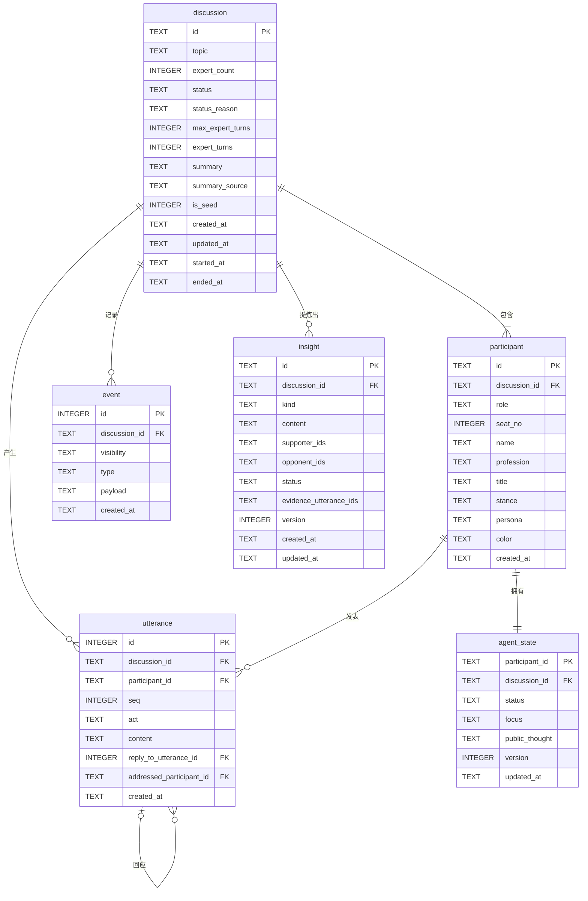
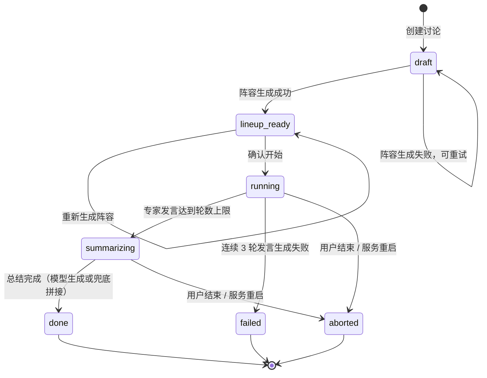

# 数据模型与讨论状态机

本文档定义 SQLite 中的 6 张表和讨论的状态流转。业务规则见 [PRD.md](PRD.md)，接口见 [API.md](API.md)。

## 约定

- 讨论、嘉宾、共识与分歧条目的 id 用 `TEXT` 存 32 位 UUID 十六进制串，放在 URL 里不会被顺序猜到。
- 发言和事件的 id 用 `INTEGER` 自增，同时承担排序。事件 id 直接作为 SSE 的 `id`。
- 时间统一存 `TEXT`，格式为 UTC 的 ISO 8601，例如 `2026-11-18T08:30:00Z`。
- 列表类字段（如认同者 id 列表）存 `TEXT` 格式的 JSON 数组。MVP 阶段整条读取，不按这些字段做联表查询。
- 布尔值存 `INTEGER`，0 或 1。
- 数据库开启 WAL 模式和外键约束（`PRAGMA journal_mode=WAL`、`PRAGMA foreign_keys=ON`），后台任务写入时，读请求不会被阻塞。

## ER 图

## 字段说明

### discussion：讨论

| 字段 | 类型 | 约束 | 含义 |
| --- | --- | --- | --- |
| id | TEXT | 主键 | 讨论 id |
| topic | TEXT | 非空，5～200 字 | 讨论话题 |
| expert_count | INTEGER | 非空，2～6 | 专家人数，不含主持人 |
| status | TEXT | 非空，取值见状态机 | 当前状态 |
| status_reason | TEXT | 可空 | 进入 `failed` 或 `aborted` 的原因，中文，可直接显示，例如“服务重启” |
| max_expert_turns | INTEGER | 非空，默认 12 | 专家发言轮数上限 |
| expert_turns | INTEGER | 非空，默认 0 | 已完成的专家发言轮数 |
| summary | TEXT | 可空 | 主持人的自然语言总结，纯文本 |
| summary_source | TEXT | 可空，`llm` 或 `fallback` | 总结来自模型，还是来自后端的兜底拼接 |
| is_seed | INTEGER | 非空，默认 0 | 是否为预设样例 |
| created_at | TEXT | 非空 | 创建时间 |
| updated_at | TEXT | 非空 | 最后修改时间 |
| started_at | TEXT | 可空 | 进入 `running` 的时间 |
| ended_at | TEXT | 可空 | 进入 `done`、`failed` 或 `aborted` 的时间 |

### participant：主持人与专家

| 字段 | 类型 | 约束 | 含义 |
| --- | --- | --- | --- |
| id | TEXT | 主键 | 嘉宾 id |
| discussion_id | TEXT | 外键，级联删除 | 所属讨论 |
| role | TEXT | 非空，`host` 或 `expert` | 角色。每场讨论恰好 1 位 `host` |
| seat_no | INTEGER | 非空；与 discussion_id 联合唯一 | 座位号。主持人为 0，专家从 1 开始，只用于界面排列 |
| name | TEXT | 非空 | 姓名（虚构） |
| profession | TEXT | 非空 | 职业，例如“劳动经济学者” |
| title | TEXT | 非空 | Title，例如“某大学经济学院副教授” |
| stance | TEXT | 非空，最多 40 字 | 对话题的立场，一句话 |
| persona | TEXT | 非空，最多 120 字 | 背景和说话风格，写进该嘉宾的提示词，界面上也公开显示 |
| color | TEXT | 非空，`#RRGGBB` | 专属颜色，后端从固定色板分配，同一场讨论内不重复 |
| created_at | TEXT | 非空 | 创建时间 |

### utterance：Transcript 中的公开发言

| 字段 | 类型 | 约束 | 含义 |
| --- | --- | --- | --- |
| id | INTEGER | 主键，自增 | 发言 id |
| discussion_id | TEXT | 外键 | 所属讨论 |
| participant_id | TEXT | 外键 | 发言人 |
| seq | INTEGER | 非空；与 discussion_id 联合唯一 | 本场讨论内的发言序号，从 1 开始连续递增 |
| act | TEXT | 非空 | 发言性质，取值见下表 |
| content | TEXT | 非空，最多 2 句、120 字 | 发言内容 |
| reply_to_utterance_id | INTEGER | 外键，可空 | 回应的是哪条发言。`supplement`、`rebut` 必填 |
| addressed_participant_id | TEXT | 外键，可空 | 发言点名的对象。主持人 `question` 必填 |
| created_at | TEXT | 非空 | 发言时间 |

`act` 的取值：

| 值 | 谁会用 | 界面标签 |
| --- | --- | --- |
| opening | 主持人 | 开场 |
| question | 主持人 | 追问 |
| bridge | 主持人 | 串联 |
| closing | 主持人 | 收尾 |
| point | 专家 | 观点 |
| supplement | 专家 | 补充 |
| rebut | 专家 | 反驳 |
| answer | 专家 | 回应 |

总结存在 `discussion.summary`，不写进 `utterance`。总结的长度超过单条发言限制，界面上也单独显示。

### event：事件流

每条状态变化、发言、条目更新和内部决策都追加一条事件。表只追加，不修改。

| 字段 | 类型 | 约束 | 含义 |
| --- | --- | --- | --- |
| id | INTEGER | 主键，自增 | 事件 id，也是 SSE 的 `id`。全局递增，同一场讨论内单调递增但不连续 |
| discussion_id | TEXT | 外键；与 id 建联合索引 | 所属讨论 |
| visibility | TEXT | 非空，`public` 或 `internal` | `public` 事件可以下发给浏览器；`internal` 事件只留在后端 |
| type | TEXT | 非空 | 事件类型，见下表 |
| payload | TEXT | 非空，JSON 对象 | 事件数据。`public` 事件的数据结构见 API.md |
| created_at | TEXT | 非空 | 事件时间 |

`public` 事件类型（SSE 中的 `event` 名见 API.md）：

| type | 触发时机 |
| --- | --- |
| discussion.status_changed | 讨论状态变化 |
| utterance.created | 新增一条发言 |
| agent_state.updated | 某位嘉宾的小窗状态、关注点或公开思考摘要变化 |
| insight.upserted | 新增或更新一条共识与分歧条目 |
| summary.ready | 总结生成完毕 |
| discussion.error | 讨论因错误终止前，给旁观者的中文说明 |

`internal` 事件类型，任何接口都不返回：

| type | 内容 |
| --- | --- |
| expert.intent | 一轮里每位专家的意图：是否想发言、举手还是抢答、发言性质、针对谁、紧迫度 |
| floor.granted | 调度器选中了谁，以及每位候选人的得分 |
| host.directive | 主持人决定追问谁或串联哪些观点 |
| insight.rejected | 提炼结果中被丢弃的条目和原因，例如引用了不存在的发言 |
| llm.call | 一次模型调用的用途、耗时、token 用量、是否成功 |

### insight：共识与分歧条目

两种条目用同一张表。共识的 `content` 是大家认同的一句结论；分歧的 `content` 是有争议的那个命题，认同者和反对者分别站在两边。

| 字段 | 类型 | 约束 | 含义 |
| --- | --- | --- | --- |
| id | TEXT | 主键 | 条目 id |
| discussion_id | TEXT | 外键 | 所属讨论 |
| kind | TEXT | 非空，`consensus` 或 `divergence` | 共识或分歧 |
| content | TEXT | 非空，最多 80 字 | 共识的结论，或分歧的争议命题 |
| supporter_ids | TEXT | 非空，JSON 数组，可为空数组 | 认同 `content` 的嘉宾 id |
| opponent_ids | TEXT | 非空，JSON 数组，可为空数组 | 反对 `content` 的嘉宾 id。分歧条目两边都至少 1 人 |
| status | TEXT | 非空 | `emerging` 初现、`confirmed` 确认、`resolved` 已化解（仅分歧）、`dropped` 已推翻 |
| evidence_utterance_ids | TEXT | 非空，JSON 数组，至少 1 个 | 支撑这一条的发言 id，后端校验这些发言属于本场讨论 |
| version | INTEGER | 非空，从 1 开始 | 每次更新加 1，前端据此丢弃过期数据 |
| created_at | TEXT | 非空 | 创建时间 |
| updated_at | TEXT | 非空 | 最后更新时间 |

### agent_state：嘉宾小窗

每位嘉宾一行，存当前状态。历史变化记录在 `event` 表的 `agent_state.updated` 事件里。主持人也有一行，前端可以决定是否显示。

| 字段 | 类型 | 约束 | 含义 |
| --- | --- | --- | --- |
| participant_id | TEXT | 主键，外键 | 对应的嘉宾 |
| discussion_id | TEXT | 外键，建索引 | 所属讨论，冗余存储，方便一次查出整场 |
| status | TEXT | 非空，默认 `idle` | `idle` 待机、`preparing` 准备发言、`speaking` 发言中 |
| focus | TEXT | 可空，最多 20 字 | 当前关注点 |
| public_thought | TEXT | 可空，最多 60 字 | 公开思考摘要。来自意图收集时模型单独输出的字段，与模型的隐藏推理无关 |
| version | INTEGER | 非空，从 1 开始 | 每次更新加 1 |
| updated_at | TEXT | 非空 | 最后更新时间 |

## 讨论状态机

| 状态 | 含义 | 允许的操作 |
| --- | --- | --- |
| draft | 讨论已创建，还没有可用阵容 | 重新生成阵容 |
| lineup_ready | 阵容已生成，等待用户确认 | 重新生成阵容、开始 |
| running | 后台任务正在推进讨论 | 结束 |
| summarizing | 正在生成总结 | 结束 |
| done | 正常结束，有总结 | 只读 |
| failed | 因模型连续失败而终止 | 只读 |
| aborted | 被用户结束，或服务重启时中断 | 只读 |

几条规则：

- `summarizing` 没有通往 `failed` 的路径。总结生成失败时，后端用已有条目拼出兜底总结，照样进入 `done`。
- `done`、`failed`、`aborted` 是终态。状态变化只能沿图中的箭头进行，后端在一个函数里集中校验，非法变化返回 409。
- 首页列表不显示 `draft`。

## 预设样例数据

`backend/db/seed.py` 导入 5 场讨论，`is_seed` 为 1，每场带 1 位主持人和 4 位专家，话题分别属于科技、医疗、教育、商业和社会。

| 话题领域 | 状态 | 内容 |
| --- | --- | --- |
| 科技、医疗 | done | 15 条发言、4～5 条共识与分歧、总结，以及对应的 public 事件。首页打开就有完整讨论可看 |
| 教育、商业、社会 | lineup_ready | 只有阵容。用户点开即可开始，不需要等阵容生成 |

脚本可重复执行：每次先删除 `is_seed = 1` 的讨论（级联删除关联数据），再重新插入。样例的 id 由固定 key 经 UUID5 派生，重复导入后不变。
