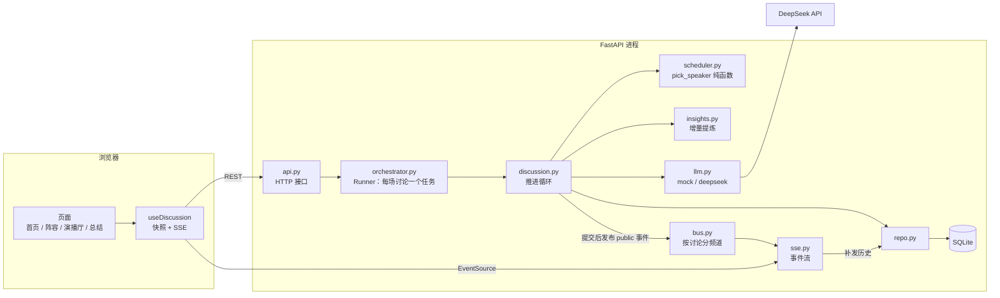
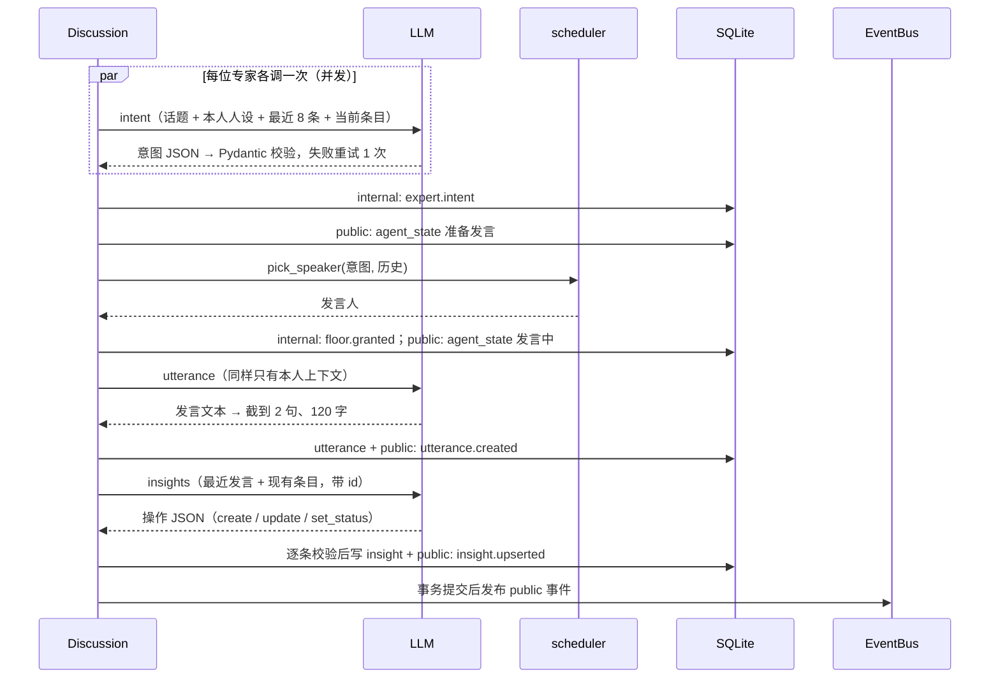

# 架构说明

本文档说明系统的模块划分、一轮发言的完整时序和几处关键的设计取舍。需求见 [PRD.md](PRD.md)，数据模型见 [ER.md](ER.md)，接口契约见 [API.md](API.md)。

## 模块划分

| 模块 | 职责 | 不负责 |
| --- | --- | --- |
| `api.py` | 参数校验、状态检查、错误格式 | 讨论推进 |
| `orchestrator.py` | 登记和取消后台任务；并发 start 只有一个成功；重启时把进行中的讨论标为中止 | 讨论内容 |
| `discussion.py` | 一场讨论的全部上下文和推进循环 | 选人规则、条目合并规则 |
| `scheduler.py` | 输入意图和发言历史，输出下一位发言人 | 任何 I/O |
| `insights.py` | 校验并应用提炼操作，写条目和事件 | 调用模型 |
| `llm.py` | 统一调用入口，JSON 校验与重试，丢弃隐藏推理内容 | 业务含义 |
| `repo.py` | 所有 SQL；状态变化用条件更新 | 状态机以外的业务规则 |
| `bus.py` / `sse.py` | 按讨论分频道转发 public 事件；断点续传 | internal 事件 |

## 一轮发言的时序

每 3 条专家发言后，主持人插入一次追问或串联。追问点名发言最少的专家，下一轮由这位专家直接回答。

## 关键设计取舍

### 意图逐位专家调用，而不是一次调用全部

**做法**：每轮为每位专家单独调用一次模型，提示词里只有话题、本人的人设、最近 8 条公开发言和当前条目，几次调用并发执行。

**理由**：一次调用生成全部专家的意图，等于让同一个模型替所有人想好下一步，专家之间不会有真正的信息差。逐位调用后，每位专家看不到其他人的意图，交锋来自各自对公开发言的反应。真实模型评测的基线场次里，12 条专家发言有 9 条是点名反驳。

**代价**：每轮的调用次数从 1 次变成 N 次（4 位专家时一场约 85 次调用，约 ¥0.07）。并发执行使等待时间基本不变。

### 选人交给纯函数，而不是交给模型

**做法**：模型只负责给出意图和紧迫度（1～5），由 `pick_speaker` 按「紧迫度最高、同分时沉默最久、最多连续 2 次」的规则选人。

**理由**：「不能机械轮流」这条要求可以单元测试，选人结果可复现，也便于解释为什么是这个人发言。

**代价**：互动方式受规则约束。真实模型评测的基线场次里，seq 7～12 的 5 条专家发言全部来自两位专家的对攻，另外两位专家被晾在一边；后续可以加发言次数的惩罚项。

### 事件分 public 和 internal 两层

**做法**：事件表只追加。意图、调度决策、模型调用记录、被拒绝的提炼操作写 `internal`；发言、小窗状态、条目、状态变化、总结写 `public`。SSE 查询时只读 `public`，事件总线在发布时再过滤一次。

**理由**：「Transcript 不显示举手等内部事件」由数据层保证，前端没有机会显示它们。`internal` 事件保留了调度和模型调用的完整记录，评测和排查问题时可以回放。

### 共识与分歧只接受「操作」，不接受整表

**做法**：模型每次输出 `create`、`update`、`set_status` 三种操作。每个操作单独校验：引用的发言和嘉宾必须存在；站队的人必须在证据里有本人的发言；更新后的分歧两边都至少一人。不合格的操作丢弃并写 `internal` 事件，其余照常写入。整段输出不是合法 JSON 时什么都不改。

**理由**：重写整表时，模型一次坏输出就可能清空已有条目；按操作增量更新，坏输出的影响只限于这一条。逐条校验把「和 transcript 对不上」的条目挡在数据库之外。

### 断点续传：快照加游标

**做法**：前端先请求详情接口，拿到快照和 `last_event_id`，再用 `?after=last_event_id` 打开 SSE。后端先订阅、再补发数据库中的事件、最后接实时事件，按事件 id 去重。断线后浏览器自动带 `Last-Event-ID` 重连，后端从断点补发。

**理由**：中途加入和断线重连是同一个问题，用同一套机制解决。E2E 用「服务端每 3 秒主动断开」让重连真实发生，并在讨论进行中检查页面上的发言没有空洞。

### 每场讨论的上下文只在自己的任务里

**做法**：发言历史、调度状态、当前条目都是 `Discussion` 实例的字段，实例只存在于这场讨论的 `asyncio.Task` 里。进程级只有任务登记表、事件总线和每场讨论一把锁，都按 `discussion_id` 索引。

**理由**：多场讨论并行时互不可见。代价是进程重启后上下文丢失，目前把进行中的讨论标为中止。

## 质量保障

| 层次 | 内容 | 数量 |
| --- | --- | --- |
| 数据库约束 | 枚举、长度、JSON 格式、外键、每场一位主持人 | `schema.sql` |
| 后端测试 | 嘉宾生成、状态机、调度、提炼、隔离、SSE、总结、禁止项 | 64 个 |
| 端到端测试 | 主流程、两场隔离、中途加入、断线重连、禁止项、三种视口 | 8 个 |
| 真实模型评测 | `scripts/live_run.py` 跑一场并导出报告，`scripts/check_attribution.py` 核对站队证据 | 按需运行 |
